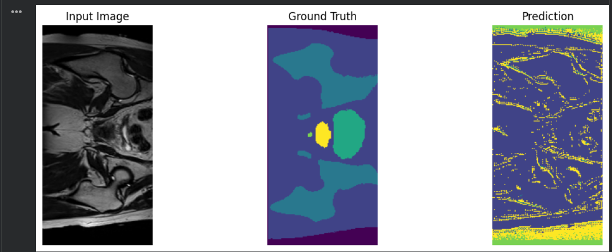
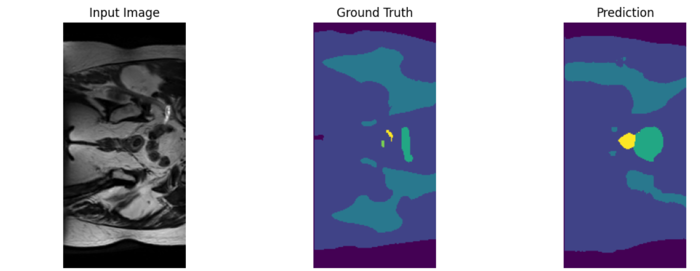

# Recognition Tasks
- Image segmentation.

This project uses a 2D Improved-UNet for image segmentation of the keras_slices_data dataset which is based in hip MRI's. The problem that it solves is that it lets doctors see the organs of a paitent given a hip MRI. 

# Artifical intelligence disclaimer
AI was used in this project.

Tools used: Chat GPT for code generation and debugging.

How it assisted me: It generated the 2D Improved UNet model for me. It changed the load_data_2D() function to reject images with 256x144 resolution. It gave me a starting point which I based putting my training, testing and verification data into lists on. It created the training and testing loops and implemented the verification system. It created the image generation example at the end of predict.py. It implemented the dice, loss, IoU results in the training and testing loops. It helped me figure out an issue wherein the size of my classes were too small. I got the AI to create the basic 2D UNet to create the comparison between the two models.

I used AI to create the code that created a graph that plots the loss function over epochs which is featured in image-2 and image-3.

I audited the code by first checking if there was any issues with runtime (e.g. exceptions thrown by the torch functions). I then checked the output of the model by giving the model a image, getting the output and plotting it to see if the output was consistent with what was required of the model.

# Feasibility report (from a word doc)
## Disclaimer
Please keep in mind that this is the original feasibility report and the dataset was initally based off the keras_slices_png_data which contains .png images rather than the keras_slices_data which contains .nii images. Items of interest include the resolution of the images (keras_slices_data images = 256x128 whereas keras_slices_png_data images = 256x256) being different between datasets etc...

## The report

Intended user: The intended user is for medical staff. 

Model: 2D-improved UNet for image segmentation. 

The plan is to get a Standard global Sørensen-Dice similarity coefficient greater than 0.75. 

We will start off with a standard 2D U-net and then add in shortcuts and other characteristics that define it as a 2D-Improved U-net. This will give us a performance benchmark. 

Dataset: 

HipMRI 2D slices (keras_slices_data). 

The total size of the dataset will be 11338 files. This will be split into 1120 files for validation, 9664 files for training and 554 files for testing. 

Images are 256 x 256 and are black and white (1 channel). We will be putting it in batches of 4. So what we'll have is 4x1x256x256 for dimensions. We can then encode this down from 256x256 down to 1 and then back up to 256x256. 

We will be using Nifti loading to preserve exact spacial alignment between images and ground truth masks. We will enforce strict paitent level splitting of the dataset. We will use intensity normalization and ground truth masks.  

Difficulty band: Normal, 

Course concepts: This is dealing with the bread and butter of the course since we are working with medical imaging training, image segmentation and Demo 2 Task 4 Medium difficulty has us working with U-Net. 

Since we have dealt with U-Net and the keras_slices_data dataset before I don’t think it will cost too many resources and my current plan is to try and do as much as I can from google collab and train the model on rangpur when necessary. We will benchmark the model by looking at the per-class Sørensen-Dice similarity coefficients and the Intersection-over-Union on the test split. 

Workable fallback: If the Improved U-Net isn’t working out, I can fall back to the 2D-U-net (on the easy difficulty band). 

Key technical risks would be patient data leaking. 

Computing budget/Resource constraint: The computing budget when using google collab is 12.7 GB of RAM, 107GB of disc space and a T4 GPU with 16GB of VRAM. Alternatively, we can use rangpur where we have access to a NVIDA A100 GPU with 40GB or 80GB of VRAM and 7.5GB of disc space but limited usage since it's shared with the other members of the course. 

# Dependencies
The project depends on the following librarys:
- numpy (version 2.5.0)
- glob (python version 3.5)
- torch (version 2.15.0)
- cv (version 5.0.0)
- os (standard python library)
- NiBabel (version 5.4.2)
- tqdm (version 2.2.4)
- matplotlib (version 3.11.2)

# Example input, ground truth and output of the untrained model
Given that the 2D Improved Unet is not trained yet, here's the output from the model given a input and the corrosponding ground truth.


Here's the trained 2D Improved UNet input, ground truth and output:


# Pre-processing
The dataset was already pre-processed into training, training_seg, testing, testing_seg, validation and validation_seg so I just used what was provided to me. I normalized the training set using cv2. Here's the code snippet of that:

```
#NORMALIZE
for image in training_image_array:
  image = cv2.normalize(
    image, None, alpha=0, beta=255, norm_type=cv2.NORM_MINMAX)
for image in training_image_array_seg:
  image = cv2.normalize(
  image, None, alpha=0, beta=255, norm_type=cv2.NORM_MINMAX)
```
After normalizing, I created a torch Dataset loader wrapper for the training, testing and validation sets.

# Benchmarking the Improved 2D Unet vs a basic 2D Unet
## Basic 2D UNet:
### Training and validation stats:

Dice coefficient per class:

Class 0: 0.8060

Class 1: 0.8247

Class 2: 0.2988

Class 3: 0.2024

Class 4: 0.0677

Class 5: 0.1274

Val Loss: 1.1088 | Pixel Accuracy: 74.7197% | mIoU: 0.2947
Train Loss: 0.1238 | Val Loss: 1.1088

### Testing stats:

Test Loss:       0.9350

Pixel Accuracy:  77.3791%

Mean IoU:        0.3150

Mean Dice:       0.4030


Dice coefficient per class:

Class 0: 0.8581

Class 1: 0.8411

Class 2: 0.3436

Class 3: 0.2259

Class 4: 0.0484

Class 5: 0.1008


IoU per class:

Class 0: 0.7514

Class 1: 0.7258

Class 2: 0.2075

Class 3: 0.1273

Class 4: 0.0248

Class 5: 0.0530


## Stats of the 2D Improved UNet:
### Training and validation stats:

Dice coefficient per class:

Class 0: 0.8191

Class 1: 0.8430

Class 2: 0.2693

Class 3: 0.2667

Class 4: 0.1041

Class 5: 0.0881

Val Loss: 1.5821 | Pixel Accuracy: 76.6900% | mIoU: 0.3055
Train Loss: 0.0543

### Testing stats:

Test Loss:       1.2936

Pixel Accuracy:  79.0729%

Mean IoU:        0.3396

Mean Dice:       0.4376


Dice coefficient per class:

Class 0: 0.8681

Class 1: 0.8573

Class 2: 0.3003

Class 3: 0.3377

Class 4: 0.1322

Class 5: 0.1303


IoU per class:

Class 0: 0.7670

Class 1: 0.7502

Class 2: 0.1766

Class 3: 0.2032

Class 4: 0.0708

Class 5: 0.0697


As we can see, the 2D Improved UNet has higher IoU, dice and lower loss than the basic 2D UNet
# Dataset failures
There were a few failures with the dataset. Most of the images come in 1 channel with 256x128 pixels, however, a few outliers came with 1 channel and 256x144 pixels. This caused the nifti function (load_data_2D()) to fail because it creates a numpy array based on the first image which was 256x128 so when the function tried to load a 256x144 file into the array, there wasn't enough allocated space and the function threw an error. Here's the creation of the numpy array:
```
if categorical:
        first_case = to_channels(first_case, dtype=dtype)
        rows, cols, channels = first_case.shape
        images = np.zeros((num, rows, cols, channels), dtype=dtype)
    else:
        rows, cols = first_case.shape
        images = np.zeros((num, rows, cols), dtype=dtype)
```

Here's where the error would throw for a 256x144 image:
```
if categorical:
            inImage = to_channels(inImage, dtype=dtype)
            images[valid_idx, :, :, :] = inImage
        else:
            images[valid_idx, :, :] = inImage
```

To fix this, I reimplemented the load_data_2D() function to ignore the 256x144 images, thus reducing the overall database size we can use but also making the database usable with nifti formatting.

For the specific cases that failed because of this, there was case_019_week_1_slice_34.nii.gz, case_019_week_1_slice_11.nii.gz, case_019_week_1_slice_43.nii.gz, case_019_week_1_slice_5.nii.gz, case_019_week_1_slice_55.nii.gz, all of which were in the training segment and had a resolution of 256x144

# Quantitative Benchmarking and resource profile of the model
## Training and validation data
Dice coefficient per class:

Class 0: 0.8191

Class 1: 0.8430

Class 2: 0.2693

Class 3: 0.2667

Class 4: 0.1041

Class 5: 0.0881

Val Loss: 1.5821 | Pixel Accuracy: 76.6900% | mIoU: 0.3055
Train Loss: 0.0543
## Testing data
Test Loss:       1.2936

Pixel Accuracy:  79.0729%

Mean IoU:        0.3396

Mean Dice:       0.4376


Dice coefficient per class:

Class 0: 0.8681

Class 1: 0.8573

Class 2: 0.3003

Class 3: 0.3377

Class 4: 0.1322

Class 5: 0.1303


IoU per class:

Class 0: 0.7670

Class 1: 0.7502

Class 2: 0.1766

Class 3: 0.2032

Class 4: 0.0708

Class 5: 0.0697


GPU VRAM data:

Total VRAM: 4716442.0199179845 MB

Used VRAM: 661445.2114821324 MB

Free VRAM: 4054996.808435852 MB

The parameters of the model were 8113766.

Inference time for the model on a T4 GPU: 0.009158134460449219 seconds

# Working principles
To make sure that I document all AI usage involved in the project and make appropriate references when required. That I try and keep good progress and put the work in. That I ultimately learn something from this project.

# Instructions
Keep in mind that the dataset this model is built to take in is the keras_slices_data.

In dataset.py, please alter the path constants at the top of the file to wherever your keras_slices_data folder is, ideally use the absolute path since it failed when I tried using a relative path (this goes for all path constants).

In modules.py, please change the MODEL_SAVE_LOCATION to wherever you want to place your saved model, also alter the batch_size in the same file if you desire a different size.

In training.py, please change the EARLY_STOP_LOADING if you want to enable or disable early stoppage of loading.

Please make sure that you have the required packages as stated in the Dependencies header above.

To run a prediction using predict.py, alter the LOAD_PATH constant to where you have your model.pth file.

If you want to train the model then run training.py, this will automatically run dataset.py and modules.py where appropriate to load data and load the model to ultimately, train the model. Run predict.py if you want an example of the output.

# References

Pytorch documentation: https://docs.pytorch.org/docs/2.15/index.html